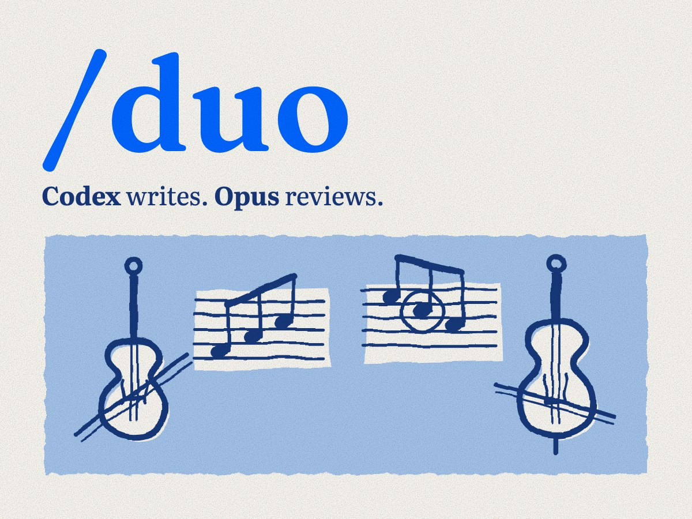
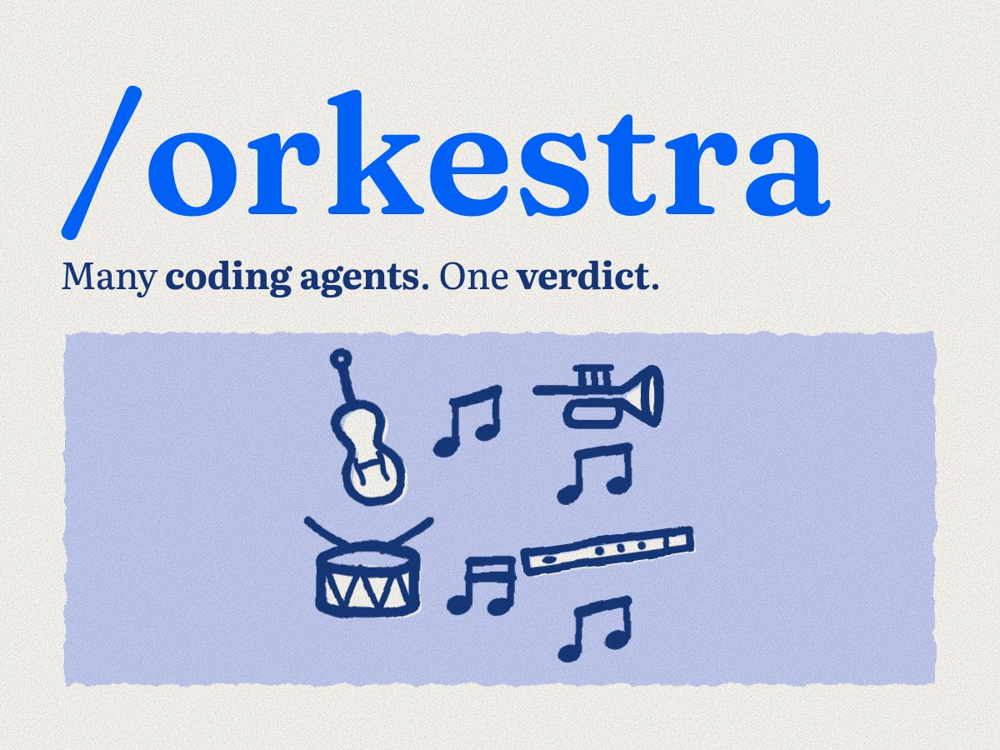
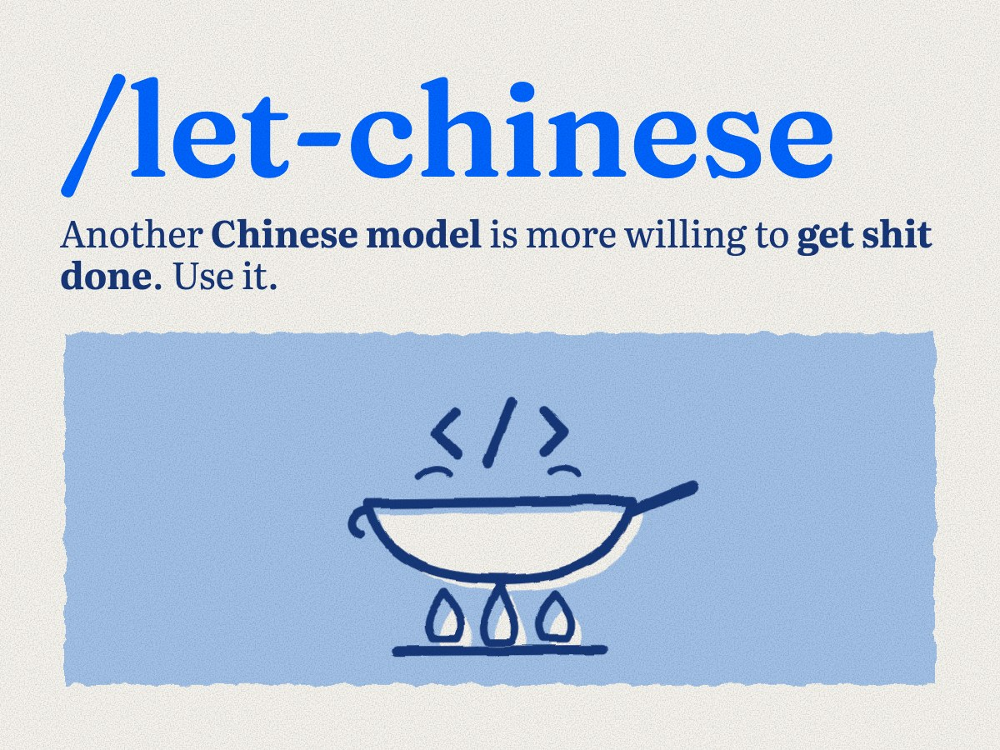
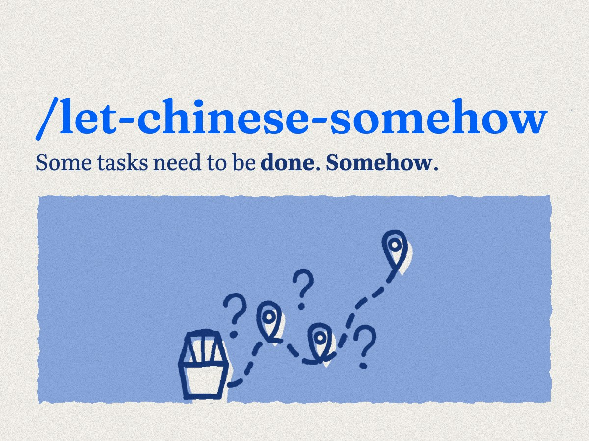
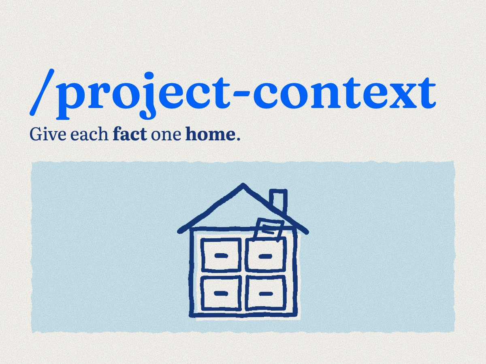

# Niche Skills

**Very niche skills I use every day.**

I'm [Yaman Can](https://github.com/yamancan). This is my personal collection of agent skills: workflows I keep coming back to, written down so I can reuse them and you can make them your own.

They're organized around the work: coding, building a startup, working with a team, and the very specific tasks in between. **Coding and Team are available now.**

[Collections](#collections) · [Install](#install) · [First use](#first-use) · [Setup guide](docs/installation.md) · [Security](SECURITY.md)

## Collections

| Collection | What it's for | Status |
| --- | --- | --- |
| [**Coding**](#coding) | Delegate coding tasks, get a second review, and manage project context. | Available · 5 skills |
| **Startup** | Work through startup decisions and the individual tools that support them. | Planned |
| [**Team**](#team) | Keep shared work, decisions, and follow-ups clear. | Available · 3 skills |
| **Very Niche** | Solve the oddly specific problems that keep coming back. | Planned |

Install a collection as a pack or pick individual skills.

## Coding

<table>
  <tr>
    <td><a href="skills/duo/SKILL.md"></a></td>
    <td><a href="skills/orkestra/SKILL.md"></a></td>
  </tr>
  <tr>
    <td><a href="skills/let-chinese/SKILL.md"></a></td>
    <td><a href="skills/let-chinese-somehow/SKILL.md"></a></td>
  </tr>
  <tr>
    <td><a href="skills/project-context/SKILL.md"></a></td>
    <td></td>
  </tr>
</table>

For Claude Code and Codex. Choose by the job you want done:

| When you want to… | Use | What it does |
| --- | --- | --- |
| Get a second model's review of a change | [**Duo**](skills/duo/SKILL.md) | Pairs Codex and Claude/Opus, keeping the same peer conversation for follow-ups. |
| Coordinate several independently owned tasks | [**Orkestra**](skills/orkestra/SKILL.md) | Organizes ownership, dependencies, and integration. Includes Duo. |
| Give a focused task to OpenCode | [**Let Chinese**](skills/let-chinese/SKILL.md) | Runs a worker with your selected supported provider/model, or a free OpenCode model with no key; your main agent checks the result. |
| Use Dolly 1 Security through Zro | [**Let Chinese Somehow**](skills/let-chinese-somehow/SKILL.md) | Runs the Zro/OpenCode route with automatic OpenCode approvals. |
| Fix conflicting or missing agent instructions | [**Project Context**](skills/project-context/SKILL.md) | Audits the repository's instructions and proposes changes to its context. |

## Team

Turn a Telegram chat into context another AI can read: lossless text chunks first, then summaries of decisions, commitments and open questions where every point cites its source message. It works from a Telegram Desktop JSON export, with no Telegram login, bot or extra API key.

| When you want to… | Use | What it does |
| --- | --- | --- |
| Prepare an export for AI reading | [**tg-cleanup**](plugins/team/skills/tg-cleanup/SKILL.md) | Splits one conversation into lossless, size-limited text chunks by day, week or month. No summaries. |
| Summarize a prepared chat, or resume one | [**tg-summarize**](plugins/team/skills/tg-summarize/SKILL.md) | Writes chunk, period and overview summaries with source citations, one bounded job at a time. |
| Do both in one go | [**Telegram Context**](plugins/team/skills/telegram-context/SKILL.md) | Runs preparation and summarization together, and ships the engine the other two use. |

Packages stay on your machine and are not anonymized: they keep the names and text in the export.

## Install

Choose one method per agent. Each plugin installs one collection; the npm shortcuts let you choose skills and agents.

<details>
<summary><strong>Claude Code · plugins</strong></summary>

```bash
claude plugin marketplace add yamancan/skills
claude plugin install niche-coding@yamancan  # Coding
claude plugin install niche-team@yamancan    # Team
```

Installs across your projects. Start a fresh session after installation.

</details>

<details>
<summary><strong>Codex · plugins</strong></summary>

```bash
codex plugin marketplace add yamancan/skills
codex plugin add niche-coding@yamancan  # Coding
codex plugin add niche-team@yamancan    # Team
```

Start a fresh session after installation.

</details>

**Choose individual skills:**

```bash
npx niche-skills
```

Or use the GitHub shortcut:

```bash
npx yamancan/skills
```

Both open the same selection flow. Choosing Orkestra includes Duo; choosing tg-cleanup or tg-summarize includes telegram-context. See the [setup guide](docs/installation.md) for prerequisites, global installs, scripted commands, and other agents.

The Coding helpers support macOS/Linux with Python **3.9+** and Git; the Team skills need only Python **3.9+**. The npm route also needs Node.js **22.20+**. Bring your own coding tools and provider accounts; model calls can incur charges. Complete [first-use setup](docs/installation.md#set-up-once) for your chosen skill before delegating work.

## First use

Start with **Project Context** to inspect the instructions your agent receives. It needs no additional provider account.

In Codex with the plugin installed:

```text
$niche-coding:project-context Audit this repo's agent instructions. Find conflicts and missing context, then propose changes.
```

In Claude Code, use `/niche-coding:project-context`. With an npm-installed skill in Codex, use `$project-context`.

Once Duo is configured, try a focused change with a peer review:

```text
$niche-coding:duo Fix the failing checkout test. Have the peer review the diff and test results.
```

Your current agent owns the change and resolves the review findings.

For Team, export a chat from Telegram Desktop in JSON format, then:

```text
$niche-team:telegram-context Process ~/Downloads/TelegramExport/result.json into a new package. Use weekly chunks and English summaries focused on decisions and open questions.
```

## Keep it current

Update plugins through your plugin manager and npm-installed skills through Skills CLI. See [update commands and auto-update settings](docs/installation.md#update).

## Trust and limits

The skills use your accounts. Credentials and private task history stay outside the distribution; selected task context goes to the model provider. Workers run with the parent's OS permissions. The Zro route uses automatic approvals, so review the [security boundaries](SECURITY.md) before using it.

Read [tested versions and known limits](docs/verification.md), including the outstanding live checks for Zro 0.3.0 and OpenRouter.

## License and credits

[MIT](LICENSE). Read the skills, adapt them, and use what fits your work. External tools keep their own licenses and terms. Duo setup was inspired by Matt Pocock's Wizard approach.
